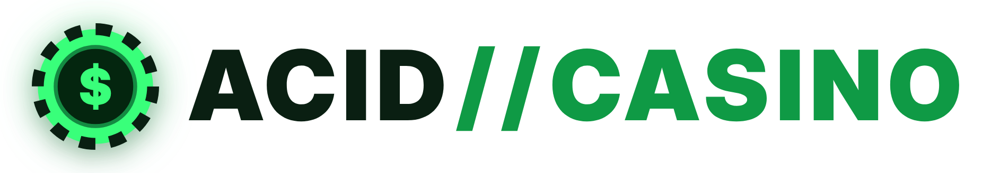
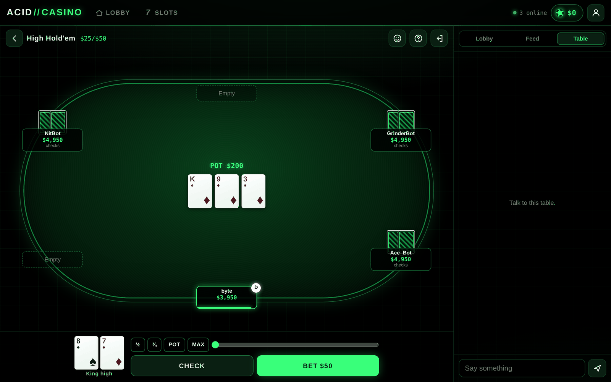
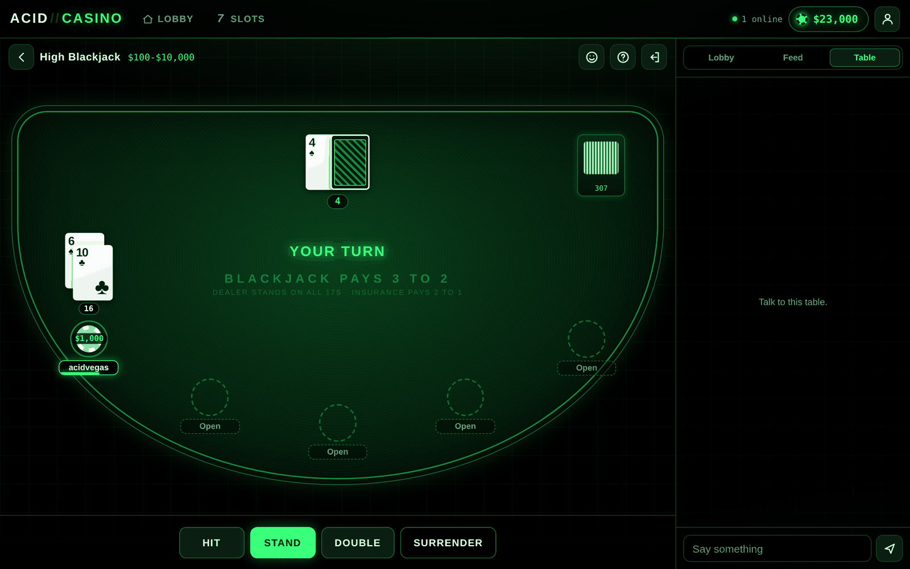
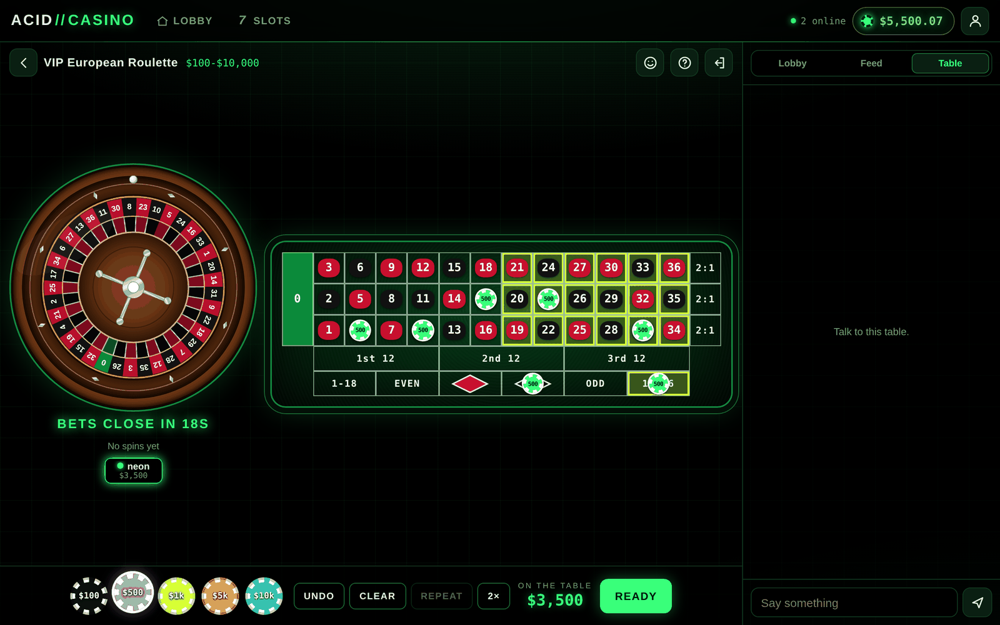
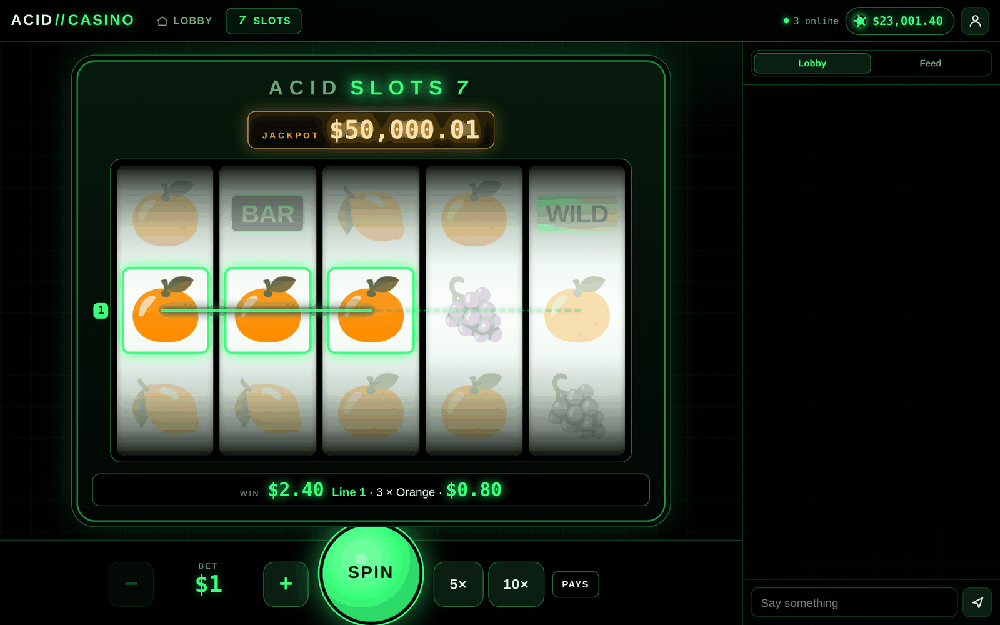
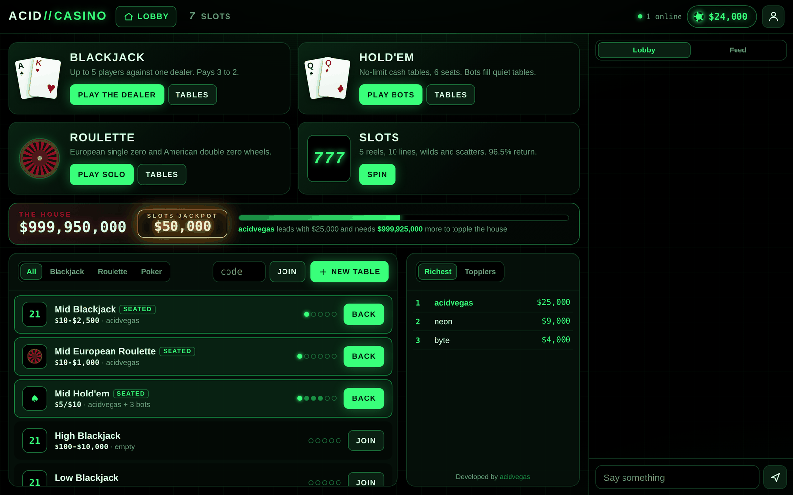
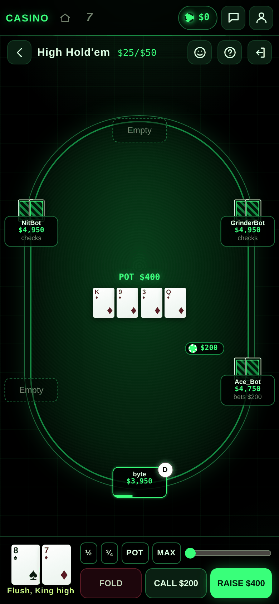

<h1 align="center">
  <picture>
    <source media="(prefers-color-scheme: dark)" srcset=".github/logo-dark.png">
    
  </picture>
</h1>

<p align="center"><b>Blackjack, no-limit Texas Hold'em, roulette and slots in the browser with play chips, built with Flask.</b></p>

<p align="center">
  <a href="https://casino.supernets.org"></a>
</p>

<p align="center">
  
  
  
  
  <a href="LICENSE"></a>
</p>

<p align="center">
  
</p>

## Screenshots

<table>
  <tr>
    <td width="50%"></td>
    <td width="50%"></td>
  </tr>
  <tr>
    <td align="center"><i>Blackjack</i></td>
    <td align="center"><i>European roulette with bets on the layout</i></td>
  </tr>
  <tr>
    <td width="50%"></td>
    <td width="50%"></td>
  </tr>
  <tr>
    <td align="center"><i>Slots</i></td>
    <td align="center"><i>The lobby, with the house bankroll and the slots jackpot</i></td>
  </tr>
</table>

<p align="center">
  <br>
  <i>Playing Hold'em on a phone</i>
</p>

## Features

- Accounts only *(username, password and a captcha)*. Every new account starts with $1,000 in chips
- Chips are tracked in cents with a full ledger of every bet and payout
- The house starts with $1,000,000,000. Every blackjack, roulette and slots bet is won from or paid by it, and poker bots play with its money. The goal is to topple it: the first time a player is worth more than the house, it is announced in the lobby and they go into the hall of fame for good, with a crown next to their name everywhere
- The house always covers its bets. No single bet may be able to win more than 0.1% of the bankroll, so table limits, the biggest slot spin, roulette bets and poker bots all scale down as the house shrinks *(at $1B nothing is limited)*. The slots jackpot is money already set aside, and the house always keeps back the $50,000 it needs to start the next one. A table the house can not cover shows as closed until it earns its way back
- Loans come straight from the house, right away, up to your credit limit. Each account has a credit score from 300 to 850 *(new accounts start at 600)* that sets the limit and the daily interest, charged every hour:

  | Score   | Credit limit | Interest a day |
  |---------|--------------|----------------|
  | 300-499 | $1,000       | 10%            |
  | 500-599 | $5,000       | 7%             |
  | 600-699 | $10,000      | 5%             |
  | 700-779 | $25,000      | 3%             |
  | 780-850 | $50,000      | 2%             |

- Paying a debt off within 3 days of it opening adds 25 points, within 7 days 10 *(at most once a day)*. Every day a debt stays open past 3 days takes 5, and borrowing right up to the limit takes 15. Nobody can owe more than $50,000, interest included. A quarter of the profit of every win goes to the debt, and it can be paid back by hand at any time
- Loans stop while the house is under $400,000,000 and start again once it climbs back above that
- To keep alternate accounts from farming the house: an account must be a day old and have bet $1,000 before it can borrow, players in debt can only play poker against bots, nobody can borrow while seated at a poker table with other people, accounts under a day old or with less than $1,000 bet can only play poker against bots, and only one account per IP address a day gets the starting chips
- Running dry? Under $250 with nothing on a table, you can ask for a free $1,000 refill with no debt. It arrives 24 hours later
- Lobby with every open table, the house bankroll against the richest player, a live feed of every win and loss *(its own tab beside the chat)*, a leaderboard of the richest players *(chips plus poker stacks minus debt)*, the hall of fame, a lobby chat for everyone and a chat at each table
- Table chat pops up as a bubble by the speaker's seat, placed wherever it covers the least of the cards, chips and names. Seated players can send emoji reactions that float up from their seat, and tip the dealer $1, $5, $25 or $100 *(tips go to the house)*
- House tables at every stake that are always open, plus tables anyone can start: public, private with an invite link, or solo against the dealer. Player tables close two minutes after the last person leaves
- Flood limits: an account can have 3 tables of its own open at once and an IP address 5 *(so alternate accounts can not flood the lobby)*, and an IP address can hold 20 live update streams at once
- Live updates over Server-Sent Events, so everyone at a table sees every card as it lands
- Built to fit the screen without scrolling, from phones held upright to wide desktops, with dealing, flipping, chip and reel animations

### Blackjack

- Up to 5 players at a table, each playing their own hands against one dealer in seat order
- Once the first bet is down everyone has 12 seconds to bet, or the round deals as soon as everyone seated is ready. Each hand gets 20 seconds before it stands on its own
- 6-deck shoe per table shuffled with a cryptographic RNG, a burn card after every shuffle, and a reshuffle at the 50% cut card *(early enough that counting cards does not pay)*. Hold'em gets a fresh shuffled deck every hand and burns a card before the flop, turn and river
- Blackjack pays 3 to 2, dealer stands on all 17s and peeks for blackjack with an ace or ten showing
- Insurance pays 2 to 1, late surrender gives back half the bet
- Double on any first two cards, also after a split
- Split pairs *(and any two ten-value cards)* up to 4 hands. Split aces get one card each and can not be split again. 21 on a split hand is not a blackjack
- Four table limits, like a real casino: $1-$500, $10-$2,500, $100-$10,000 and a VIP $500-$50,000. Bets in play are refunded if the server restarts mid-round

### Roulette

- Two wheels: European with a single zero and American with 0 and 00, each with the real pocket order and red and black numbers, at three house tables apiece. Player tables work like blackjack: public, private with an invite link or solo
- Up to 6 players at a table, all betting on the same spin, each with their own chip colour on the felt. Once the first chip is down everyone has 20 seconds to bet, or the ball goes round as soon as everyone seated is ready. The pocket is drawn when the betting closes and every screen lands the ball in it
- Every standard bet: straight up 35 to 1, split 17 to 1, street 11 to 1 *(including the trios with zero)*, corner 8 to 1 *(and the first four 0-1-2-3 on the European wheel)*, six line 5 to 1, the American top line 0-00-1-2-3 at 6 to 1, dozens and columns 2 to 1, and red, black, odd, even, 1-18 and 19-36 at even money. Outside bets lose on zero, with no la partage
- Every bet returns 36/37 on the European wheel *(a 2.7% house edge)* and 36/38 on the American one *(5.26%)*, except the top line at 35/38 *(7.89%)*
- Limits per spot and per spin: Low $1-$100 *($1,000 a spin)*, Mid $10-$1,000 *($10,000)* and VIP $100-$10,000 *($100,000)*. The most a spin could win a player must fit in the house cover. Chips on the felt are refunded if the server restarts mid-spin
- Chip picker, undo, clear, repeat last bet and double, a highlight of the numbers a bet covers, a marker on the winning number and a board of the last numbers

### Poker

- No-limit Texas Hold'em cash tables, 6 seats each, at six stakes *(Micro $0.25/$0.50 up to VIP $100/$200)*. No-limit, so there is no maximum bet. Buy in for 40 to 250 big blinds; joining a game already going means posting a big blind to be dealt in
- Full betting rules: heads-up blinds, minimum raises, short all-ins that do not reopen the betting, side pots, split pots and odd chips to the first winner left of the button
- Computer players fill in when a table is quiet *(up to 4 players)* and leave as people sit down, always keeping a seat open. Player tables can turn bots off
- 25 seconds to act. Time out twice and you sit out; after 10 minutes sitting out, or 2 minutes with the site closed, you are stood up and your chips go back to your balance
- Stacks are saved at the end of every hand. After a restart everyone is cashed out at their stack from the start of the hand that was cut off

### Slots

- 5 reels, 3 rows, 10 fixed lines, with a wild and a scatter. Each winning line is drawn in its own color and numbered, and the win meter steps through every win with what made it and what it paid
- Bets from $1 to $1,000 a spin, with 5 and 10 spin auto runs
- 96.5% return to player, worked out exactly from the reel strips and pay table *(see `slots.rtp()`)* and checked against a simulation in the tests
- A jackpot shared by everyone, shown on the machine and in the lobby. The house puts 1% of every bet into it, on top of the 96.5%, and seeds it with $50,000, again after every win. Any spin can hit it, with a chance of the bet in cents in 5,000,000,000: 1 in 50,000 at $1,000 and 1 in 5,000,000 at $1. Over the long run it adds 1.1% to the return *(the 1% put in plus the seed of every win, see `slots.jackpot_rtp()`)*. The pot is kept in the database and every move in and out of it is in the ledger

Cards, shoes, reel stops, the jackpot draw and the roulette pocket come from Python's `secrets` module.

## Run it

```bash
CASINO_BIND=127.0.0.1 ./setup.sh
```

The app listens on port 20005. `CASINO_PROXIES` is the number of reverse proxies in front of it, so the real client address is used. `setup.sh` sets `1`, since it publishes the port on 127.0.0.1 for nginx; leave it at `0` when the app is reached directly.

Set `CASINO_PUBLIC_URL` *(e.g. `https://casino.acid.vegas`)* when the casino is served on more than one domain, so the canonical link, share cards, robots.txt and sitemap all point at the main one. Unset, they use whatever host the request came in on.

For development:

```bash
python3 -m venv .venv
.venv/bin/pip install -r requirements.txt
cd acidcasino && ../.venv/bin/python app.py
```

Data lives in `data/` *(or `CASINO_DATA_DIR`)*.

## acid-arcade-db

By default the casino keeps its own accounts. Set `ARCADE_URL` and accounts live in acid-arcade-db instead, so the same username and password work on every acid-arcade game *(each site still signs in on its own)*. Signup, login and logout go to the account server, the local `users` table becomes a mirror that gets a 600 credit score the first time an account shows up *(and the $1,000 starting chips, if no other account from that IP address got them in the last day)*, renames and deleted accounts are picked up every minute, and each player's net worth, chips, loans, credit score and hall of fame spot are pushed to their arcade profile. Players show their profile picture next to their name, and the account menu links to the arcade site for password, picture and account changes. If the account server is down the casino answers 503 instead of falling back to guests.

Players also earn chips outside the casino: beating the computer in the other arcade games, a daily login streak, daily missions and achievement bounties. acid-arcade-db works out every reward and the casino polls it every 15 seconds, paying each one once from the house bankroll *(shown in the wallet as an `arcade` ledger line, with a link to the arcade's rewards page)*. Rewards wait until the account is a day old and has opened the casino. Finished blackjack hands, poker hands *(not bots)* and roulette spins are reported in the background for the daily missions; slots never are.

| Variable            | Description                                                                           |
|---------------------|---------------------------------------------------------------------------------------|
| `ARCADE_URL`        | Internal acid-arcade-db API, e.g. `http://acid-arcade-db:20021`. Unset means standalone |
| `ARCADE_PUBLIC_URL` | Public arcade site used for pictures and account settings. `{domain}` is replaced with the player's parent domain, so `chess.supernets.org` links to `arcade.supernets.org` *(setup.sh defaults it to `https://arcade.{domain}`)* |
| `ARCADE_GAME`       | This game's slug in acid-arcade-db *(`casino`, set by setup.sh)*                       |
| `ARCADE_KEY`        | This game's key, needed when acid-arcade-db has `ARCADE_GAME_KEYS` set                 |
| `CASINO_KEY`        | Shared key other arcade games send as `X-Casino-Key` to the internal API. Unset turns the internal API off |

With `ARCADE_URL` set, `setup.sh` also joins the container to the `arcade` docker network.

### Internal API

Port `20006` answers only on the `arcade` docker network and is never published. Other arcade games use it to take chips out of the casino *(Wall Street deposits)*. The chips leave the economy, the house gets nothing, and the transfer shows in the wallet as a ledger line named after the game.

| Route                   | Body                              | Reply                          |
|-------------------------|-----------------------------------|--------------------------------|
| `POST /internal/chips`  | `{user_id}`                       | `{balance, owed, in_play}` or 404 |
| `POST /internal/debit`  | `{user_id, amount, game, ref}`    | `{balance}` or 400 with the reason |

`amount` is in cents, at most $10,000. A player with a loan, or with chips on a table, can not send chips. `ref` is the calling game's id for the transfer: a repeat of it is answered with the first result and takes nothing, so a timed out call can be retried safely.

## Tests

```bash
python3 -m unittest discover -s tests
```

---

###### Mirrors: [SuperNETs](https://git.supernets.org/acidvegas/) • [GitHub](https://github.com/acidvegas/) • [GitLab](https://gitlab.com/acidvegas/) • [Codeberg](https://codeberg.org/acidvegas/)
